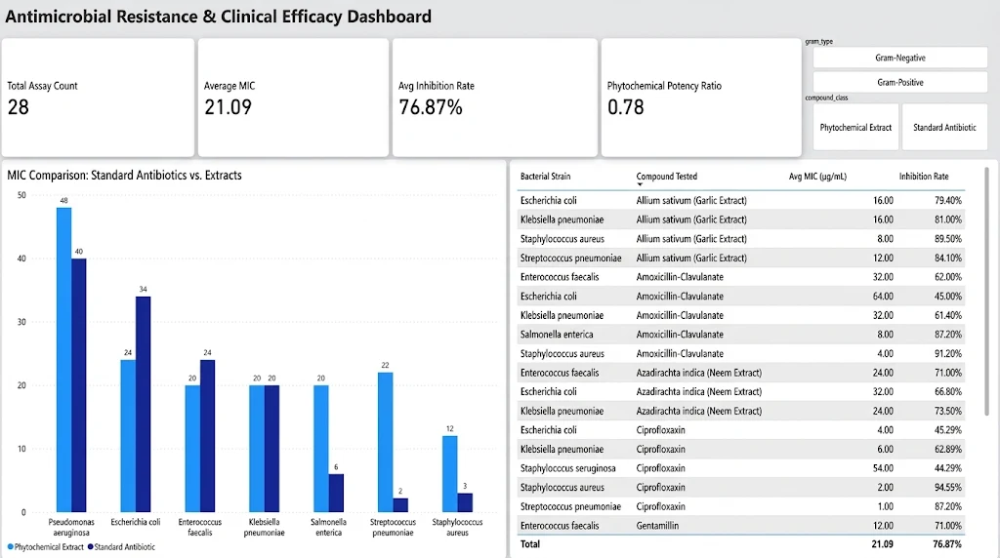

# Comparative Clinical Assay Analysis & Efficacy Dashboard
**Author:** Onuorah Ifechukwu Miracle  
**Role:** Certified Data Analyst  
**Tech Stack:** SQL (PostgreSQL), Power BI, DAX, Advanced Excel

---

## Executive Overview
This clinical data project evaluates the comparative efficacy of plant-derived phytochemical extracts against conventional pharmaceutical antibiotics across multi-drug resistant bacterial strains. 

By structuring raw Minimum Inhibitory Concentration (MIC) assay datasets, performing statistical aggregations in SQL, and developing an interactive executive dashboard in Power BI, this analysis provides clinical researchers with clear potency benchmarks.

---

## Executive Dashboard


---

## Technical Architecture & Workflow
1. **Relational Data Modeling:** Architected a star schema consisting of two dimension tables (`Dim_Bacterial_Strains`, `Dim_Compounds`) and one central fact table (`Fact_MIC_Assays`).
2. **Advanced SQL Analytics (`analysis.sql`):**
   * Benchmarked compound potency tiers using `CASE` statements and group aggregations.
   * Evaluated Gram-positive vs. Gram-negative strain resistance profiles via Common Table Expressions (CTEs).
   * Ranked the most potent therapeutic alternatives for each pathogen using the `DENSE_RANK()` window function.
3. **Power BI & DAX Modeling:**
   * Built custom measures for dynamic KPI tracking (`[Total Assay Count]`, `[Average MIC]`, `[Avg Inhibition Rate]`, and `[Phytochemical Potency Ratio]`).
   * Implemented categorical slicers for interactive pathogen and compound class filtering.

---

### Sample SQL: Potency Ranking via Window Functions
```sql
WITH RankedEfficacy AS (
    SELECT 
        s.strain_name,
        s.gram_type,
        c.compound_name,
        c.compound_class,
        f.mic_value_ug_ml,
        DENSE_RANK() OVER (
            PARTITION BY s.strain_name 
            ORDER BY f.mic_value_ug_ml ASC
        ) AS efficacy_rank
    FROM Fact_MIC_Assays f
    JOIN Dim_Bacterial_Strains s ON f.strain_id = s.strain_id
    JOIN Dim_Compounds c ON f.compound_id = c.compound_id
)
SELECT 
    strain_name,
    gram_type,
    compound_name AS most_effective_agent,
    compound_class,
    mic_value_ug_ml AS lowest_mic_recorded
FROM RankedEfficacy
WHERE efficacy_rank = 1
ORDER BY strain_name;
